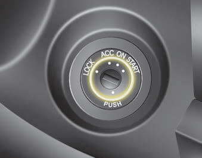

# Kia Sportage: Interruptor de ignição iluminado

[Home](../../index.md) / [Manual do proprietário do Kia Sportage SL](../sportage-1236.md) / [Dirigindo seu veículo](sportage-1508.md) / [Posições da chave](sportage-1513.md) / Interruptor de ignição iluminado

Cada vez que uma porta dianteira for aberta, o interruptor de ignição será iluminado para sua conveniência, desde que o interruptor de ignição não esteja na posição ON. A luz se apagará imediatamente quando o interruptor de ignição for ligado. Ela também se apagará após aproximadamente 30 segundos quando a porta for fechada.
