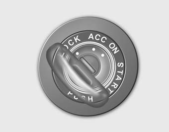

# Kia Sportage: Posição do interruptor de ignição

[Home](../../index.md) / [Manual do proprietário do Kia Sportage SL](../sportage-1236.md) / [Dirigindo seu veículo](sportage-1508.md) / [Posições da chave](sportage-1513.md) / Posição do interruptor de ignição

**LOCK**

O volante é bloqueado para proteção contra roubos (se equipado). A chave de ignição pode ser removida apenas na posição LOCK. Ao girar o interruptor de ignição para a posição LOCK, empurre a chave para dentro na posição ACC e gire a chave na direção da posição LOCK.

**ACC (Acessório)**

O volante é desbloqueado e os acessórios elétricos estão operativos.

Se houver dificuldade ao girar o interruptor de ignição para a posição ACC, gire a chave enquanto girar o volante para a direita e para a esquerda para liberar a tensão.

**ON**

As luzes de advertência podem ser verificadas antes de ligar o motor. Esta é a posição de funcionamento normal após o motor ser ligado.

Não deixe o interruptor de ignição ON se o motor não estiver ligado para evitar a descarga da bateria.

**START**

Gire o interruptor de ignição para a posição START para ligar o motor. O motor girará até que você solte a chave; então, retorna à posição ON. A luz de freio pode ser verificada nesta posição.

AVISO - Interruptor de ignição

*Nunca gire o interruptor de ignição para LOCK ou ACC enquanto o veículo estiver em movimento. Isso resultaria em perda do controle de direção e da função de freio, o que poderia causar um acidente.*

O bloqueio antirroubo da coluna do volante não é substituto do freio de estacionamento. Antes de sair do assento do motorista, sempre verifique se a alavanca de câmbio está engatada em 1ª marcha para a transmissão manual ou em P (Park) para a transmissão automática, estabeleça o freio de estacionamento completamente e desligue o motor. Movimento inesperado e repentino do veículo pode ocorrer se essas precauções não forem tomadas.
