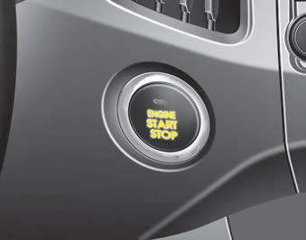

# Kia Sportage: Botão DE INÍCIO E PARADA iluminado

[Home](../../index.md) / [Manual do proprietário do Kia Sportage SL](../sportage-1236.md) / [Dirigindo seu veículo](sportage-1508.md) / [Botão de início e parada do motor](sportage-1517.md) / Botão DE INÍCIO E PARADA iluminado

Cada vez que a porta dianteira for aberta, o botão DE INÍCIO E PARADA do motor será iluminado para sua conveniência. A luz se apagará após aproximadamente 30 segundos quando a porta for fechada. Ela também se apagará imediatamente quando o sistema antifurto for armado.
