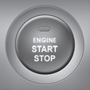

# Kia Sportage: DESLIGADO

[Home](../../index.md) / [Manual do proprietário do Kia Sportage SL](../sportage-1236.md) / [Dirigindo seu veículo](sportage-1508.md) / [Botão de start/stop do motor](sportage-1517.md) / [Posição do botão START/STOP do motor](sportage-1519.md) / DESLIGADO

• Com transmissão automática

Para desligar o motor (posição START/RUN) ou a energia do veículo (posição ON), pressione
o botão START/STOP do motor com o maneta do câmbio na posição P (Park). Quando
você pressionar o botão START/STOP do motor sem a maneta do câmbio na posição P (Park), o botão
START/STOP do motor não mudará para a posição DESLIGADO, mas para a posição ACC.

Em uma situação de emergência enquanto o veículo estiver em movimento, você pode desligar
o motor e passar para a posição ACC pressionando o botão START/STOP do motor por mais de 2 segundos
ou 3 vezes consecutivas dentro de 3 segundos. Se o veículo ainda estiver em movimento, você pode
reiniciar o motor sem pressionar o pé do freio, pressionando o botão START/STOP do motor com a maneta do câmbio na posição N (Neutral).
