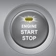

# Kia Sportage: LIGADO

[Home](../../index.md) / [Manual do proprietário Kia Sportage SL](../sportage-1236.md) / [Dirigindo seu veículo](sportage-1508.md) / [Botão de ligar/parar do motor](sportage-1517.md) / [Posição do botão DESENVOLVER/PARAR DO MOTOR](sportage-1519.md) / LIGADO

Indicador verde

• Com transaxle automático

Pressione o botão DESENVOLVER/PARAR DO MOTOR enquanto estiver na posição ACC sem pressionar o pedal do freio.

É possível verificar as luzes de advertência antes de ligar o motor. Não deixe o botão DESENVOLVER/PARAR DO MOTOR na posição LIGADO por muito tempo. A bateria pode descarregar, pois o motor não está em funcionamento.
