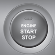
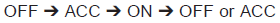

# Kia Sportage: INÍCIO/INSTRUÇÕES DE PARTIDA

[Home](../../index.md) / [Manual do proprietário Kia Sportage SL](../sportage-1236.md) / [Dirigindo seu veículo](sportage-1508.md) / [Botão de partida/parada do motor](sportage-1517.md) / [Posição do botão de partida/parada do motor](sportage-1519.md) / INÍCIO / INSTRUÇÕES DE PARTIDA

Não iluminado

• Com transaxle automático

Para iniciar o motor, pressione o pedal do freio e pressione o botão DEPARTIDA/PARADA DO MOTOR com o maneta do câmbio na posição P (Park) ou N (Neutral). Para sua segurança, inicie o motor com o maneta do câmbio na posição P (Park).

Se você pressionar o botão DEPARTIDA/PARADA DO MOTOR sem pressionar o pedal do freio para veículos com transaxle automático, o motor não será iniciado e o botão DEPARTIDA/PARADA DO MOTOR mudará para:

*NOTA*

*Se você deixar o botão DEPARTIDA/PARADA DO MOTOR na posição ACC ou ON por um tempo prolongado, a bateria será descarregada.*

AVISO - Início do veículo

*Nunca pressione o botão DEPARTIDA/PARADA DO MOTOR enquanto o veículo estiver em movimento, a menos que seja em uma emergência. Se o motor parar enquanto o veículo estiver em movimento, isso resultará em perda de controle de direção e função de freio, o que pode causar um acidente.*
