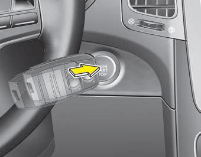

# Kia Sportage: Iniciando o motor com uma chave inteligente

[Home](../../index.md) / [Manual do proprietário Kia Sportage SL](../sportage-1236.md) / [Dirigindo seu veículo](sportage-1508.md) / [Botão de início/parada do motor](sportage-1517.md) / Iniciando o motor com uma chave inteligente

1. Carregue a chave inteligente ou deixe-a dentro do veículo.

2. Certifique-se de que o freio de estacionamento esteja bem aplicado.

3. Transaxle Automático - Coloque o alavanca do câmbio em P (Park). Pressione completamente o pedal do freio.

4. Pressione o botão INÍCIO/PARADA DO MOTOR enquanto pressiona o pedal do freio.

O motor deve ser iniciado sem pressionar o acelerador.

5. Não espere que o motor aqueça enquanto o veículo permanecer parado.

Inicie a viagem com velocidades moderadas do motor. (Acelerar e desacelerar bruscamente devem ser evitados.)

- Mesmo que a chave inteligente esteja no veículo, se ela estiver longe de você, o motor pode não iniciar.
- Quando o botão INÍCIO/PARADA DO MOTOR estiver na posição ACC ou acima, se qualquer porta for aberta, o sistema verificará pela presença da chave inteligente. Se a chave inteligente não estiver no veículo, o indicador "KEY OUT" piscará. E se todas as portas estiverem fechadas, o sininho tocará por 5 segundos. O indicador ou advertência se apagará enquanto o veículo estiver em movimento. Sempre leve a chave inteligente consigo.

AVISO - Movimento não intencional do veículo

*Nunca deixe a chave inteligente no veículo com crianças ou ocupantes do veículo que não estejam familiarizados com a operação do veículo. Pressionar o botão INÍCIO/PARADA DO MOTOR com a chave inteligente no veículo pode resultar no acionamento não intencional do motor e/ou no movimento não intencional do veículo.*

- Se a bateria estiver fraca ou a chave inteligente não estiver funcionando corretamente, você pode iniciar o motor pressionando o botão de início/parada do motor com a chave inteligente.

O lado com o botão de travamento deve entrar diretamente no botão de início/parada do motor. Quando você pressionar o botão de início/parada do motor diretamente com a chave inteligente, a chave inteligente deve entrar no botão formando um ângulo reto.
- Quando a fusível da luz de freio de estacionamento estiver quebrado, não será possível iniciar o motor normalmente. Substitua o fusível por um novo. Se não for possível, você pode iniciar o motor pressionando o botão INÍCIO/PARADA DO MOTOR por 10 segundos enquanto ele estiver na posição ACC. O motor pode ser iniciado sem pressionar o pedal do freio. Mas para sua segurança, sempre pressione o pedal do freio antes de iniciar o motor.

Não pressione o botão INÍCIO/PARADA DO MOTOR por mais de 10 segundos, exceto quando o fusível da luz de freio de estacionamento estiver quebrado.
