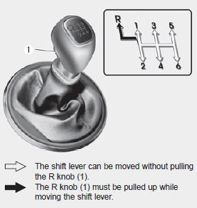

# Kia Sportage: Operação da transaxle

[Home](../../index.md) / [Manual do proprietário do Kia Sportage SL](../sportage-1236.md) / [Dirigindo seu veículo](sportage-1508.md) / [Transaxle](sportage-1525.md) / Operação da transaxle

A transaxle tem 6 marchas em frente.

Este padrão de troca de marchas está impresso no botão de troca de marchas. A transaxle é totalmente sincronizada em todas as marchas em frente, então a troca para uma marcha mais alta ou mais baixa é facilmente realizada.

Pressione completamente o pedal da embreagem ao trocar de marcha, depois solte lentamente.

Se o veículo estiver equipado com um interruptor de ignição, o motor não iniciará ao iniciar o motor sem pressionar o pedal da embreagem. (se equipado)

O alavanca de troca de marchas deve ser retornado à posição neutra antes de trocar para a R (Ré).

O anel (1) localizado imediatamente abaixo do botão de troca de marchas deve ser puxado para cima enquanto se move a alavanca de troca de marchas para a posição R. (se equipado) Certifique-se de que o veículo esteja completamente parado antes de trocar para a R (Ré).

Nunca operar o motor com o tachômetro (rpm) na zona vermelha.

CAUTION - Desengate

*Não desengate mais do que duas marchas ou desengate a marcha quando o motor estiver em alta rotação (5.000 RPM ou superior). Tal desengate pode danificar o motor.*

- Durante o frio, a troca de marchas pode ser difícil até que a lubrificação da transaxle aqueça. Isso é normal e não prejudica a transaxle.
- Se você parou completamente e é difícil trocar para a 1ª ou R (Ré), coloque a alavanca de troca de marchas na posição N (Neutro) e solte a embreagem. Pressione o pedal da embreagem de volta para baixo, e então troque para a posição 1ª ou R (Ré).

CAUTION

- *Para evitar o desgaste prematuro e o dano da embreagem, não dirija com o pé apoiado no pedal da embreagem. Além disso, não use a embreagem para manter o veículo parado em uma encosta, enquanto espera um semáforo, etc.*
- *Não use a alavanca de troca de marchas como apoio de mão durante a condução, pois isso pode resultar em desgaste prematuro das engrenagens de troca de marchas da transaxle.*

WARNING - Estacionamento em inclinação

*Antes de sair da cadeira do motorista, sempre ajuste o travamento de estacionamento completamente e desligue o motor. Em seguida, certifique-se de que a transaxle esteja na posição 1ª quando o veículo estiver estacionado em um nível ou encosta, e na posição R (Ré) em uma encosta descida. Movimento inesperado e repentino do veículo pode ocorrer se essas precauções não forem seguidas na ordem identificada.*

**Usando a embreagem**

O pedal da embreagem deve ser pressionado completamente ao chão antes de trocar de marcha, depois solte lentamente. O pedal da embreagem deve sempre ser solto completamente ao dirigir. Não apóie o pé no pedal da embreagem ao dirigir. Isso pode causar desgaste desnecessário. Não use a embreagem parcialmente para manter o carro em uma encosta. Isso causa desgaste desnecessário. Use o freio de mão ou o travamento de estacionamento para manter o carro em uma encosta. Não

operar o pedal da embreagem rapidamente e repetidamente.

**Desengate**

Quando você precisar diminuir a velocidade em tráfego intenso ou ao subir encostas
estreitas, desengate antes que o motor comece a trabalhar. Desengate diminui as
chances de travamento e oferece melhor aceleração quando você precisar aumentar
novamente a velocidade. Quando o veículo estiver descendo encostas íngremes,
desengate ajuda a manter uma velocidade segura e prolonga a vida da frenagem.
