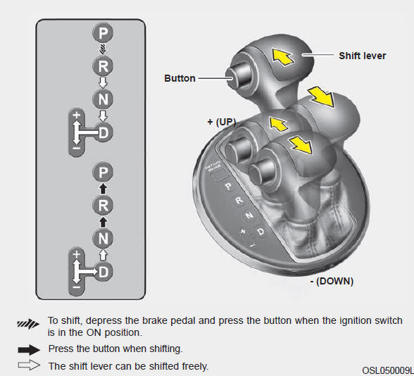

# Kia Sportage: Operação do transaxle automático

[Início](../../index.md) / [Manual do proprietário do Kia Sportage SL](../sportage-1236.md) / [Dirigindo seu veículo](sportage-1508.md) / [Transaxle automático](sportage-1528.md) / Operação do transaxle automático

O transaxle automático tem 6 velocidades em frente e uma velocidade em ré. As velocidades individuais são selecionadas automaticamente, dependendo da posição do alavanca de troca de marchas.

*✽ NOTA*

*As primeiras trocas de marcha em um novo veículo, se a bateria foi desconectada, podem ser um pouco abruptas. Isso é uma condição normal, e a sequência de trocas de marcha ajustará-se após algumas trocas de marcha serem cíclicas pelo MCT (Module de Controle do Transaxle) ou pelo MPA (Module de Controle do Potência).*

Para operação suave, pressione o pedal do freio quando trocar de N (Neutro) para uma marcha em frente ou ré.

AVISO - Saindo do veículo

*Antes de sair do seu assento de motorista, sempre verifique se a alavanca de troca de marchas está no posição P (Parado); então, estabeleça o freio de estacionamento completamente e desligue o motor. Não use a posição P como substituto do freio de estacionamento. Sempre verifique se a alavanca de troca de marchas está presa na posição P e estabeleça o freio de estacionamento completamente. O movimento inesperado e repentino do veículo pode ocorrer se essas precauções não forem seguidas.*

CUIDADO - Transaxle

*Para evitar danos ao seu transaxle, não acelere o motor em R (Ré) ou em qualquer posição de marcha em frente com o freio aplicado. O transaxle pode ser danificado se você trocar para a posição P (Parado) enquanto o veículo estiver em movimento.*

Quando parado em uma rampa, não mantenha o veículo com o poder do motor. Use o freio de serviço ou o freio de estacionamento.

- [Intervalos do transaxle](sportage-1530.md)
- [Sistema de bloqueio da troca de marchas](sportage-1531.md)
- [Sistema de interligação da chave de ignição](sportage-1532.md)
