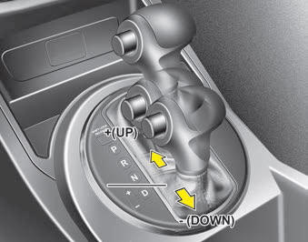

# Kia Sportage: Marchas do transaxle

[Home](../../index.md) / [Manual do proprietário do Kia Sportage SL](../sportage-1236.md) / [Dirigindo seu veículo](sportage-1508.md) / [Transaxle automático](sportage-1528.md) / [Operação do transaxle automático](sportage-1529.md) / Marchas do transaxle

O indicador no painel de instrumentos exibe a posição do manípulo de marchas quando o interruptor de ignição está na posição ON.

**P (Parque)**

Sempre pare completamente antes de mudar para a posição P (Parque). Esta posição trava o transaxle e impede que as rodas de tração rolem.

Mudar para a posição P (Parque) enquanto o veículo estiver em movimento bloqueará as rodas de tração, o que pode resultar em perda de controle do veículo.

**R (Ré)**

Use esta posição para fazer o veículo recuar.

CAUTION - Mudança

*Sempre pare completamente antes de mudar para ou de R (Ré); você pode danificar o transaxle se mudar para R (Ré) enquanto o veículo estiver em movimento, exceto quando "Rocking o veículo" explicado nesta seção.*

**N (Neutro)**

As rodas e o transaxle não estão engatados. O veículo rolará livremente, mesmo em ligeira inclinação, a menos que o freio de estacionamento ou os freios de serviço sejam aplicados.

**D (Dianteiro)**

Esta é a posição de marcha adianteira normal. O transaxle engatará automaticamente uma sequência de 6 marchas, fornecendo a economia de combustível e o poder mais eficientes.

Para maior potência ao passar por outro veículo ou ao subir encostas, pressione o acelerador completamente, na qual o transaxle engatará automaticamente uma marcha inferior.

**Modo esportivo**

Seja o veículo estacionado ou em movimento, o modo esportivo é selecionado empurrando o manípulo de marchas da posição D (Dianteiro) para a porta manual. Para retornar à operação na faixa D (Dianteiro), empurre o manípulo de marchas de volta para a porta principal.

No modo esportivo, movendo o manípulo de marchas para frente e para trás, você pode fazer trocas rápidas de marchas. Contrariamente a um transaxle manual, o modo esportivo permite trocas de marchas com o pedal do acelerador pressionado.

**+ (Cima)**: Empurre o manípulo uma vez para frente para engatar uma marcha superior.

**- (Baixo)**: Puxe o manípulo uma vez para trás para engatar uma marcha inferior.

- No modo esportivo, o motorista deve executar as trocas de marcha de acordo com as condições de tráfego, cuidando para manter a velocidade do motor abaixo da zona vermelha.
- No modo esportivo, apenas as 6 marchas superiores podem ser selecionadas. Para estacionar ou parar o veículo, mova o manípulo de marchas para as posições R (Ré) ou P (Parque) conforme necessário.
- No modo esportivo, as trocas de marcha inferior são feitas automaticamente quando o veículo diminuir de velocidade. Quando o veículo parar, a 1ª marcha será automaticamente selecionada.
- No modo esportivo, quando a rotação do motor se aproximar dos pontos de troca de marcha vermelhos, as trocas de marcha serão variadas para engatar automaticamente.
- Para manter os níveis necessários de desempenho e segurança do veículo, o sistema pode não executar certas trocas de marcha quando o manípulo de marchas for operado.
- Ao dirigir em estradas escorregadias, empurre o manípulo de marchas para frente para a posição + (Cima).

posição. Isso faz com que a transmissão mude para a 2ª marcha, que é melhor
para uma condução suave em uma superfície escorregadia. Empurre o alavanca de troca para a posição -(para baixo)- para retornar à 1ª marcha.
