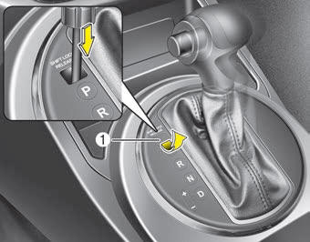

# Kia Sportage: Sistema de travamento da caixa de câmbio

[Home](../../index.md) / [Manual do proprietário Kia Sportage SL](../sportage-1236.md) / [Dirigindo seu veículo](sportage-1508.md) / [Caixa de câmbio automática](sportage-1528.md) / [Operação da caixa de câmbio automática](sportage-1529.md) / Sistema de travamento da caixa de câmbio

Para sua segurança, a caixa de câmbio automática tem um sistema de travamento que impede a troca do câmbio de P (Park) para R (Reverse) a menos que o pedal do freio seja pressionado.

Para trocar o câmbio de P (Park) para R (Reverse):

1. Pressione e mantenha o pedal do freio pressionado.

2. Inicie o motor ou gire o interruptor de ignição para a posição ON.

3. Pressione o botão de liberação do travamento e mova a alavanca de câmbio.

Se o pedal do freio for pressionado e solto repetidamente com a alavanca de câmbio na posição P (Park), pode-se ouvir um som de vibração perto da alavanca de câmbio. É uma condição normal.

AVISO - Troca de P (Park)

*Sempre pressione completamente o pedal do freio antes e durante a troca de P (Park) para outra posição para evitar movimento inadvertido do veículo, o que pode lesar pessoas dentro ou ao redor do veículo.*

**Sobrecarga do travamento do câmbio**

Se a alavanca de câmbio não puder ser movida da posição P (Park) para a posição R (Reverse) com o pedal do freio pressionado, continue pressionando o pedal do freio, e faça o seguinte:

1. Remova cuidadosamente a capa que cobre a abertura de acesso ao travamento (1).

2. Insira uma furadeira na abertura e pressione o cabo da furadeira.

3. Pressione o botão de liberação do travamento (2) e mova a alavanca de câmbio.

4. Leve seu veículo para inspeção imediata em um concessionário autorizado da Kia.
