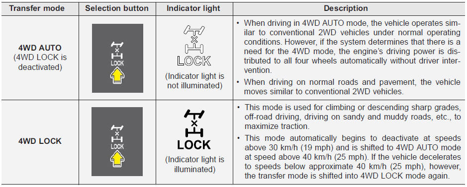

# Kia Sportage: Seleção do modo de transferência do quatro-wheel drive (4WD)

[Home](../../index.md) / [Manual do proprietário do Kia Sportage SL](../sportage-1236.md) / [Dirigindo seu veículo](sportage-1508.md) / [Quatro-wheel drive (4WD)](sportage-1535.md) / Seleção do modo de transferência do quatro-wheel drive (4WD)

Quando o modo 4WD LOCK estiver desativado, pode ocorrer um impacto ao ser entregue toda a potência de tração às rodas dianteiras. Este impacto não é um falha mecânica.

AVISO - Condições normais de estrada

*Não dirija por longos períodos de tempo em estradas normais com o seu veículo bloqueado no modo 4WD. Dirigir em estradas normais com o modo 4WD LOCK (especialmente, quando faz curvas) pode causar ruídos mecânicos ou vibrações que podem danificar sua transmissão.*
