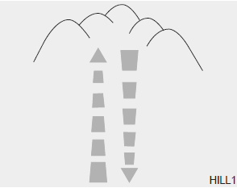
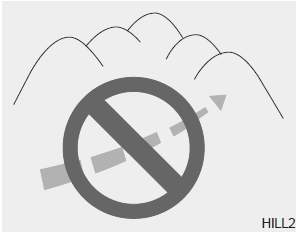
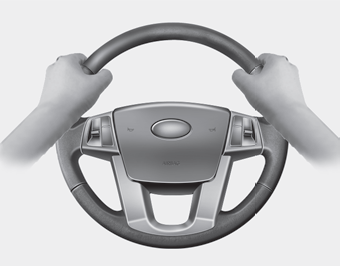
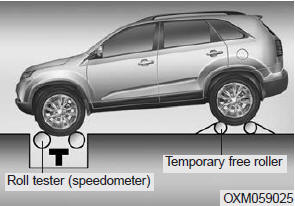

# Kia Sportage: Para operação de quatro rodas traseiras segura

[Home](../../index.md) / [Manual do proprietário Kia Sportage SL](../sportage-1236.md) / [Dirigindo seu veículo](sportage-1508.md) / [Quatro rodas traseiras (4WD)](sportage-1535.md) / Para operação de quatro rodas traseiras segura

- Não tente dirigir em água ou lama estagnada, pois essas condições podem parar o seu motor e entupir as tubulações de escape. Não dirija por encostas íngremes, pois requer habilidade extrema para manter o controle do veículo.

- Ao subir ou descer encostas, dirija o mais reta possível. Use extrema cautela ao subir ou descer encostas íngremes, pois você pode virar o veículo dependendo da inclinação, do terreno e das condições de água ou lama.

AVISO - Encostas

*Proceda com extrema cautela ao descer encostas íngremes. Um pequeno ajuste
no ângulo das rodas pode desestabilizar o veículo. Isso pode causar o veículo a rolar repentinamente sem aviso e sem tempo para você recuperar o controle do veículo.*

- Você deve conscientemente se esforçar para aprender a fazer curvas em um veículo de 4WD. Não se baseie na sua experiência em veículos convencionais de 2WD ao escolher a velocidade de curva segura em modo 4WD. De início, você deve dirigir mais devagar em 4WD.
- Dirija com cuidado fora de estrada, pois seu veículo pode ser danificado por pedras ou raízes de árvores. Familiarize-se com as condições fora de estrada onde você vai dirigir antes de começar a dirigir.

AVISO - 4WD

*Reduza a velocidade ao fazer curvas. O centro de gravidade de veículos de 4WD
é mais alto que o de veículos convencionais de 2WD, tornando-os mais propensos a rolarem
quando você faz curvas muito rápidas.*

AVISO - Volante

*Não segure o interior do volante ao dirigir fora de estrada. Você pode se machucar
com um movimento repentino do volante ou devido ao rebatimento do volante devido a impactos
com objetos no chão.*

- Sempre segure firmemente o volante ao dirigir fora de estrada.
- Certifique-se de que todos os passageiros estejam usando cinto de segurança.

AVISO - Perigo de vento

*Dirija devagar em ventos fortes. O centro de gravidade mais alto do veículo diminui
a capacidade de controle do volante.*

- Se você precisar dirigir na água, pare o veículo, configure o transfer para o modo 4WD LOCK e dirija a menos de 8 km/h (5 mph).

AVISO - Dirigindo pela água

*Dirija devagar. Se você estiver dirigindo muito rápido na água, a água pode entrar
no compartimento do motor e molhar o sistema de ignição, causando o seu veículo a parar repentinamente. Se isso acontecer e o veículo estiver em posição inclinada, o veículo pode rolar.*

*✽ NOTA*

- *Reduza o intervalo programado de manutenção se você dirigir em condições fora de estrada, como areia, lama ou água (veja "Manutenção em condições severas de uso").*

## Seção 7). Sempre lave seu veículo após uso off-road, especialmente limpando o baixo do veículo.*
- *Um veículo com tração 4x4 permanente não pode ser arrastado por um caminhão de arrasto comum. Certifique-se de que o veículo esteja posicionado em uma plataforma de caminhão para transporte.*

AVISO - Dirigindo 4WD

*Não tente realizar manobras de direção rápidas ou giros bruscos em modo 4WD. Essas manobras aumentam o risco de acidentes de rolamento. Acidentes de rolamento são extremamente violentos e imprevisíveis.*

CUIDADO - Lama ou neve

*Não deixe o motor funcionar continuamente a altas RPMs para liberar o veículo da neve ou lama. Fazê-lo poderia danificar o sistema 4WD do seu veículo.*

AVISO - Veículo levantado

*Enquanto o veículo 4WD permanente estiver sendo levantado com um jateador, nunca inicie o motor ou faça os pneus girarem.*

*Existe o risco de pneus girando tocarem no chão causarem o veículo a sair do jateador e pular para frente.*

- Veículos 4WD permanentes devem ser testados em um dinamômetro de chassis 4WD especial.
- Um veículo 4WD permanente não deve ser testado em um dinamômetro de 2WD. Se um dinamômetro de 2WD deve ser usado, realize o seguinte:

1. Verifique as pressões de pneus recomendadas para seu veículo.

2. Posicione os pneus dianteiros no dinamômetro para um teste de velocímetro conforme mostrado na ilustração.

3. Solte o travamento de estacionamento.

4. Posicione os pneus traseiros no rolo temporário como mostrado na ilustração.
