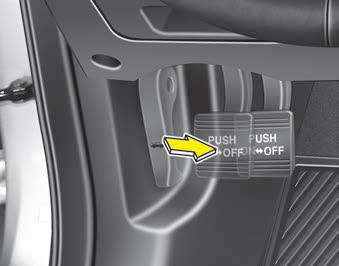
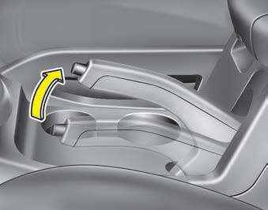

# Kia Sportage: Aplicando o freio de estacionamento

[Início](../../index.md) / [Manual do proprietário do Kia Sportage SL](../sportage-1236.md) / [Dirigindo seu veículo](sportage-1508.md) / [Sistema de freio](sportage-1539.md) / [Freio de estacionamento](sportage-1543.md) / Aplicando o freio de estacionamento

**Tipo de pé**

Para engatar o freio de estacionamento, primeiramente aplique o freio de pé e, em seguida, pressione o pedal do freio de estacionamento até o fundo.

**Tipo de mão**

Para engatar o freio de estacionamento, primeiramente aplique o freio de pé e, em seguida, sem pressionar o botão de liberação, puxe o lembrete do freio de estacionamento até o fundo.

Além disso, é recomendado que, ao estacionar o veículo em uma rampa, a alavanca de câmbio seja posicionada na marcha apropriada de baixa no caso de veículos com transmissão manual.

ATENÇÃO - Freio de estacionamento

*Dirigir com o freio de estacionamento aplicado causará um desgaste excessivo das pastilhas de freio e do disco de freio.*
