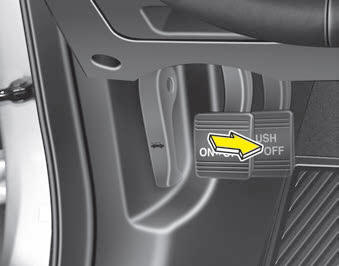
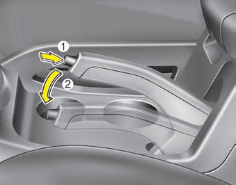
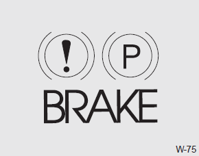

# Kia Sportage: Liberando o freio de estacionamento

[Home](../../index.md) / [Manual do proprietário do Kia Sportage SL](../sportage-1236.md) / [Dirigindo seu veículo](sportage-1508.md) / [Sistema de freio](sportage-1539.md) / [Freio de estacionamento](sportage-1543.md) / Liberando o freio de estacionamento

**Tipo de pé**

Para liberar o freio de estacionamento, pressione o pedal do freio de estacionamento uma segunda vez enquanto aplicar o freio de pedal. O pedal se estenderá automaticamente para a posição totalmente liberada.

**Tipo de mão**

Para liberar o freio de estacionamento, primeiramente aplique o freio de pedal e levante ligeiramente o freio de estacionamento. Em seguida, pressione o botão de liberação (1) e abaixe o freio de estacionamento (2) enquanto segurar o botão.

AVISO - Uso do freio de estacionamento

*Todos os veículos devem sempre ter o freio de estacionamento totalmente acionado ao estacionar para evitar o movimento acidental do veículo, o que pode lesar ocupantes ou pedestres.*

Verifique a luz de advertência de freio ligando o interruptor de ignição (não inicie o motor). Essa luz será acesa quando o freio de estacionamento estiver acionado com o interruptor de ignição na posição START ou ON.

Antes de dirigir, certifique-se de que o freio de estacionamento esteja totalmente liberado e a luz de advertência de freio esteja apagada.

Se a luz de advertência de freio permanecer acesa após o freio de estacionamento ser liberado enquanto o motor estiver em funcionamento, pode haver um problema no sistema de freio. Atenção imediata é necessária.

Se possível, pare imediatamente a direção do veículo. Se isso não for possível, operar o veículo com extrema cautela e apenas continue a dirigir o veículo até que você possa chegar a um local seguro ou oficina de reparos.
