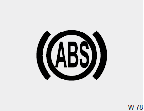

# Kia Sportage: Sistema de freio a contração eletrônica (SCE)

[Home](../../index.md) / [Manual do proprietário Kia Sportage SL](../sportage-1236.md) / [Dirigindo seu veículo](sportage-1508.md) / [Sistema de freio](sportage-1539.md) / Sistema de freio a contração eletrônica (SCE)

SCE (ou ESC) não impedirá acidentes devido a manobras de direção impróprias ou perigosas. Mesmo que a controle do veículo seja melhorado durante o freio de emergência, mantenha sempre uma distância segura entre você e objetos à frente. A velocidade do veículo deve ser reduzida em condições de estrada extremas. O veículo deve ser dirigido a uma velocidade reduzida nas seguintes circunstâncias:

- ao dirigir em estradas irregulares, de grama ou cobertas de neve
- ao dirigir com cadenas de pneus instaladas
- ao dirigir em estradas onde a superfície da estrada está irregular ou tem diferentes alturas.

Dirigir nessas condições aumenta a distância de parada do seu veículo.

O SCE continua a sentir a velocidade dos pneus. Se os pneus estiverem prestes a bloquear, o sistema SCE repetidamente modula a pressão hidráulica nos freios para os pneus.

Ao aplicar os freios em condições que possam bloquear os pneus, você pode ouvir um som "tik-tik" dos freios, ou sentir uma correspondente sensação no pedal do freio. Isso é normal e significa que o SCE está ativo.

Para obter o maior benefício do seu SCE em uma situação de emergência, não tente modulá-la a pressão dos freios e não tente pumpear os freios. Pressione o pedal do freio com todo o seu força ou com a força que a situação permitir que o SCE controle a força aplicada aos freios.

*NOTA*

*Pode-se ouvir um som de clique no compartimento do motor quando o veículo começa a se mover após o motor ser ligado. Essas condições são normais e indicam que o sistema de freio a contração eletrônica está funcionando corretamente.*

- Mesmo com o sistema de freio a contração eletrônica, o veículo ainda requer uma distância de parada suficiente. Sempre mantenha uma distância segura do veículo à frente.
- Sempre diminua a velocidade ao fazer curvas. O sistema de freio a contração eletrônica não pode impedir acidentes resultantes de velocidades excessivas.
- Em superfícies de estrada soltas ou irregulares, a operação do sistema de freio a contração eletrônica pode resultar em uma distância de parada maior do que para veículos equipados com um sistema de freio convencional.

A luz do sistema de freio a contração eletrônica permanecerá acesa por aproximadamente 3 segundos após o acionamento do interruptor de ignição. Durante esse tempo, o sistema de freio a contração eletrônica fará uma auto-diagnóstico e a luz se apagará se tudo estiver normal. Se a luz permanecer acesa, você pode ter um problema com o seu sistema de freio a contração eletrônica. Entre em contato com um revendedor autorizado da Kia o mais rápido possível.

- Ao dirigir em uma estrada com baixa tração, como uma estrada de gelo, e ter operado os freios continuamente, o SCE será ativo continuamente e a luz do sistema de freio a contração eletrônica pode acender. Pare seu carro em um lugar seguro e desligue o motor.
- Reinicie o motor. Se a luz do sistema de freio a contração eletrônica se apagar, então seu sistema de freio a contração eletrônica está funcionando corretamente.

É normal. Caso contrário, você pode ter um problema com o ABS. Entre em contato com um concessionário autorizado da Kia o mais rápido possível.

*NOTA*

*Caso você inicie a partida do seu veículo devido a uma bateria descarregada, o motor pode não funcionar tão suavemente e a luz do indicador do ABS pode acender simultaneamente. Isso acontece devido à tensão baixa da bateria. Isso não significa que o seu ABS tenha apresentado falha.*

- Não freie de forma mecânica!
- Tenha a bateria recarregada antes de dirigir o veículo.
