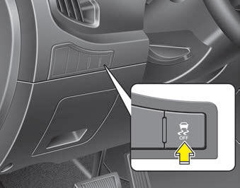

# Kia Sportage: Controle Estável Eletrônico (ESE)

[Home](../../index.md) / [Manual do proprietário Kia Sportage SL](../sportage-1236.md) / [Dirigindo seu veículo](sportage-1508.md) / [Sistema de freio](sportage-1539.md) / Controle Estável Eletrônico (ESE)

O sistema de Controle Estável Eletrônico (ESE) é projetado para estabilizar o veículo durante manobras de curva. O ESE verifica onde você está direcionando o volante e onde o veículo está realmente indo. O ESE aplica o freio em rodas individuais e intervém no sistema de gerenciamento do motor para estabilizar o veículo.

O Controle Estável Eletrônico (ESE) não previne acidentes. Velocidades excessivas em curvas, manobras bruscas e hidroplanagem em superfícies molhadas ainda podem resultar em acidentes graves. Somente um motorista seguro e atento pode evitar manobras que causem a perda de tração do veículo. Mesmo com o ESE instalado, sempre siga todas as precauções normais de direção - incluindo dirigir a velocidades seguras para as condições.

O sistema de Controle Estável Eletrônico (ESE) é um sistema eletrônico projetado para auxiliar o motorista a manter o controle do veículo em condições adversas. Não é uma substituição para práticas de direção segura. Fatores como velocidade, condições de estrada e entrada de direção do motorista podem afetar se o ESE será eficaz em prevenir a perda de controle. Ainda é sua responsabilidade dirigir e fazer curvas a velocidades razoáveis e manter uma margem de segurança suficiente.

Quando você aplicar o freio em condições que possam bloquear as rodas, você pode ouvir um som "tik-tik" dos freios, ou sentir uma correspondente sensação no pedal do freio. Isso é normal e significa que o ESE está ativo.

*✽ NOTA*

*Um som de clique pode ser ouvido no compartimento do motor quando o veículo começar a se mover após o motor ser ligado. Essas condições são normais e indicam que o Sistema de Controle Estável Eletrônico está funcionando corretamente.*

- [Operação do ESE](sportage-1548.md)
- [Operação do ESE desligado](sportage-1549.md)
- [Luz indicadora](sportage-1550.md)
- [Uso do ESE desligado](sportage-1551.md)
