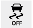

# Kia Sportage: Operação do ESC desligada

[Início](../../index.md) / [Manual do proprietário do Kia Sportage SL](../sportage-1236.md) / [Dirigindo seu veículo](sportage-1508.md) / [Sistema de freio](sportage-1539.md) / [Controle de estabilidade eletrônico (ESC)](sportage-1547.md) / Operação do ESC desligada

**Estado ESC DESLIGADO**

Para cancelar a operação do ESC:

**• Estado 1**

Pressione o botão ESC DESLIGADO por um curto período (a luz indicadora ESC DESLIGADO se acende). Neste estado, a função de controle do motor não opera. Em outras palavras, a função de controle de tração não opera, mas apenas a função de controle do freio opera.

**• Estado 2**

Pressione o botão ESC DESLIGADO por mais de 3 segundos. A luz indicadora ESC DESLIGADO se acende e um sinal de advertência sonoro será emitido. Neste estado, a função de controle do motor e a função de controle do freio não operam. Em outras palavras, a função de controle da estabilidade do veículo não opera mais.

Se o interruptor de ignição estiver na posição LOCK/OFF e o ESC estiver desligado, o ESC permanecerá desligado. Ao reiniciar o motor, o ESC ligará automaticamente novamente.
