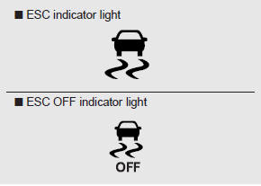

# Kia Sportage: Luz de Indicação

[Início](../../index.md) / [Manual do proprietário do Kia Sportage SL](../sportage-1236.md) / [Dirigindo seu veículo](sportage-1508.md) / [Sistema de freio](sportage-1539.md) / [Controle de estabilidade eletrônico (ESC)](sportage-1547.md) / Luz de Indicação

Quando a chave do ignição estiver ligada, a luz de indicação se acenderá, depois
se apagará se o sistema ESC estiver operando normalmente.

A luz de indicação do ESC piscará sempre que o sistema estiver operando e se acenderá
se o sistema ESC falhar em operar.

A luz de indicação ESC OFF se acenderá quando o sistema ESC for desligado com o botão.

CAUTION

*Dirigir com pneus ou rodas de tamanhos variados pode causar mal funcionamento do sistema ESC.
Ao trocar pneus, certifique-se de que eles são do mesmo tamanho dos seus pneus originais.*

WARNING - Controle de estabilidade eletrônico

*Dirija com cuidado mesmo que seu veículo tenha Controle de Estabilidade Eletrônico.
Ele pode apenas auxiliar na manutenção do controle em certas circunstâncias.*
