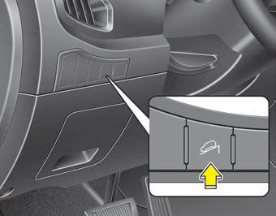
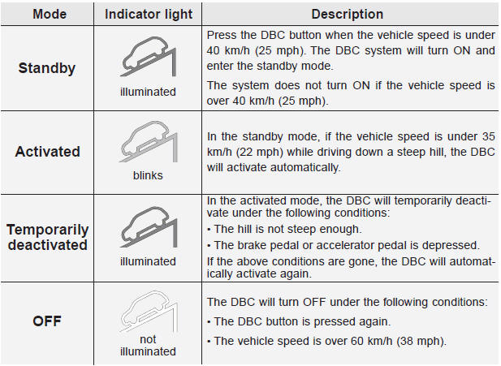

# Kia Sportage: Controle de Freio em Desce (DBC)

[Home](../../index.md) / [Manual do proprietário Kia Sportage SL](../sportage-1236.md) / [Dirigindo seu veículo](sportage-1508.md) / [Sistema de freio](sportage-1539.md) / Controle de Freio em Desce (DBC)

O Controle de Freio em Desce (DBC) auxilia o condutor a descer uma encosta
steep hill sem precisar apertar o pedal do freio. Ele diminui a velocidade do veículo
under 8 km/h (5mph) e permite que o condutor se concentre na direção do veículo.

O DBC está desativado por padrão sempre que o ignição é ligada.

O DBC pode ser ativado ou desativado pressionando o botão.

*✽ NOTA**

*Se a luz vermelha do DBC acender, o sistema esquentou demais ou há algo errado.
O DBC não será ativado. Se a luz vermelha do DBC acender mesmo após o sistema
ter esfriado, leve o sistema a um concessionário autorizado da Kia para verificação.*

- O DBC não se ativa na posição P (Park).
- O DBC pode não se ativar se o ESC (ou BAS) estiver ativado.
- Em uma encosta muito íngreme, mesmo que o pedal do freio ou do acelerador seja
apertado, o DBC pode não se desativar.
- Desative sempre o DBC em estradas normais. O DBC pode se ativar do modo de espera
quando ocorrer uma curva repentina ou ao passar por buracos.
- A luz de freio traseiro acende quando o DBC é ativado.

*✽ NOTA**

- *Pode ocorrer ruídos ou vibrações nos freios quando o DBC é ativado.*
- *O DBC pode se ativar e fazer o motor parar em veículos com transmissão manual
se você dirigir em 3ª marcha (ou superior) com o DBC ligado. Não ligue o DBC
quando dirigindo em 3ª marcha (ou superior).*
