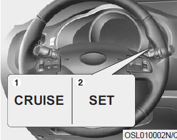

# Sistema de controle de velocidade constante da Kia Sportage: SL

[Home](../../index.md) / [Manual do proprietário da Kia Sportage SL](../sportage-1236.md) / [Dirigindo seu veículo](sportage-1508.md) / Sistema de controle de velocidade constante

1. Indicador de controle de velocidade

2. Indicador de configuração de velocidade

O sistema de controle de velocidade permite que você configure o veículo para manter uma velocidade constante sem precisar pressionar o acelerador.

Este sistema é projetado para funcionar acima de aproximadamente 40 km/h (25 mph).

Se o controle de velocidade estiver ligado (a luz CRUISE na cluster de instrumentos estiver acesa), pode-se acionar o controle de velocidade acidentalmente. Desligue o sistema de controle de velocidade (a luz CRUISE apagada) quando o controle de velocidade não estiver em uso, para evitar a configuração acidental de uma velocidade.

Use o sistema de controle de velocidade apenas quando estiver dirigindo em rodovias abertas com bom tempo.

Não use o controle de velocidade quando estiver dirigindo em tráfego intenso ou variável, ou em estradas escorregadias (chuvas, gelo ou neve) ou com curvas, ou em estradas com inclinação superior a 6%.

*NOTA*

- *Durante a operação normal do controle de velocidade, quando o botão SET for ativado
	ou reativado após aplicar o freio, o controle de velocidade será ativado após
	aproximadamente 3 segundos. O atraso é normal.*
- *Para ativar o controle de velocidade, pressione o pedal do freio pelo menos uma vez após
	ligar o interruptor de ignição para a posição ON ou iniciar o motor. Isso é para verificar se o
	switch do freio, que é uma parte importante para cancelar o controle de velocidade,
	está em condições normais.*

AVISO - Abuso do Controle de Velocidade

*Não use o controle de velocidade se a situação de tráfego não permitir que você dirija
seguramente a uma velocidade constante e com distância suficiente para o veículo à frente.*

- [Para configurar a velocidade de controle de velocidade](sportage-1557.md)
- [Para aumentar a velocidade de configuração de controle de velocidade](sportage-1558.md)
- [Para diminuir a velocidade de cruzeiro](sportage-1559.md)
- [Para acelerar temporariamente com o controle de velocidade ligado](sportage-1560.md)
- [Para cancelar o controle de velocidade, faça uma das seguintes ações](sportage-1561.md)
- [Para retomar a velocidade de cruzeiro acima de aproximadamente 40 km/h (25 mph)](sportage-1562.md)
- [Para desligar o controle de velocidade, faça uma das seguintes ações](sportage-1563.md)
