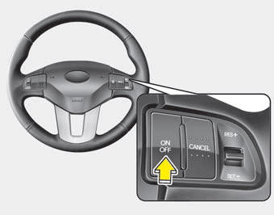
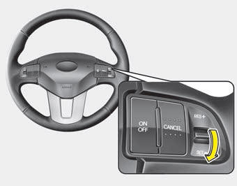

# Kia Sportage: Para definir a velocidade do controle de cruzeiro

[Home](../../index.md) / [Manual do proprietário do Kia Sportage SL](../sportage-1236.md) / [Dirigindo seu veículo](sportage-1508.md) / [Sistema de controle de cruzeiro](sportage-1556.md) / Para definir a velocidade do controle de cruzeiro

1. Pressione o botão ON-OFF do controle de cruzeiro no volante, para ligar o sistema.
A luz CRUISE na cluster de instrumentos será acionada.

2. Acelere para a velocidade desejada, que deve ser superior a 40 km/h (25 mph).

3. Pressione o botão SET - e solte-o na velocidade desejada. A luz SET no cluster de instrumentos será acionada. Solte o acelerador no mesmo momento. A velocidade desejada será mantida automaticamente.

Em uma encosta íngreme, o veículo pode diminuir ou aumentar ligeiramente de velocidade ao descer.
