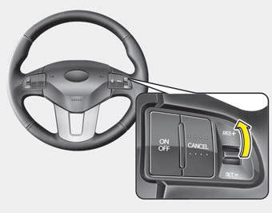

# Kia Sportage: Para aumentar a velocidade do controle de cruzeiro

[Início](../../index.md) / [Manual do proprietário do Kia Sportage SL](../sportage-1236.md) / [Dirigindo seu veículo](sportage-1508.md) / [Sistema de controle de cruzeiro](sportage-1556.md) / Para aumentar a velocidade do controle de cruzeiro

Siga qualquer um desses procedimentos:

- Pressione e segure o botão RES +. Seu veículo acelerará. Solte
	o botão na velocidade desejada.
- Pressione e solte imediatamente o botão RES +. A velocidade de cruzeiro aumentará em 2,0 km/h (1,2 mph) a cada vez que o botão RES + for operado dessa maneira.
