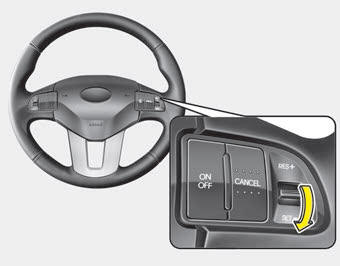

# Kia Sportage: Para diminuir a velocidade de cruzeiro

[Início](../../index.md) / [Manual do proprietário do Kia Sportage SL](../sportage-1236.md) / [Dirigindo seu veículo](sportage-1508.md) / [Sistema de controle de velocidade de cruzeiro](sportage-1556.md) / Para diminuir a velocidade de cruzeiro

Siga qualquer um desses procedimentos:

- Pressione e segure o botão - SET. Seu veículo diminuirá gradualmente de velocidade.
  Solte o botão na velocidade desejada para manter.
- Pressione e solte imediatamente o botão - SET. A velocidade de cruzeiro diminuirá em 2,0 km/h (1,2 mph) a cada vez que o botão - SET for operado dessa maneira.
