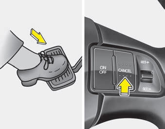

# Kia Sportage: Para cancelar o controle de cruzeiro, faça uma das seguintes ações

[Home](../../index.md) / [Manual do proprietário Kia Sportage SL](../sportage-1236.md) / [Dirigindo seu veículo](sportage-1508.md) / [Sistema de controle de cruzeiro](sportage-1556.md) / Para cancelar o controle de cruzeiro, faça uma das seguintes ações

- Pressione o pedal do freio.
- Pressione o pedal da embreagem com uma transmissão manual.
- Coloque o veículo em N (Neutro) com uma transmissão automática.
- Empurre o interruptor CANCEL localizado no volante.
- Reduza a velocidade do veículo em até 20 km/h (12 mph) abaixo da velocidade memorizada.
- Reduza a velocidade do veículo a menos de aproximadamente 40 km/h (25 mph).

Cada uma dessas ações cancelará a operação do controle de cruzeiro (a luz do indicador SET no painel de instrumentos apagará), mas não desligará o sistema. Se desejar retomar a operação do controle de cruzeiro, empurre o interruptor RES + localizado no seu volante. Você retornará à velocidade previamente estabelecida.
