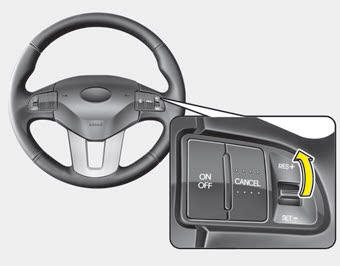

# Kia Sportage: Para retomar a velocidade de cruzeiro em mais de aproximadamente 40 km/h (25 mph)

[Início](../../index.md) / [Manual do proprietário do Kia Sportage SL](../sportage-1236.md) / [Dirigindo seu veículo](sportage-1508.md) / [Sistema de controle de velocidade de cruzeiro](sportage-1556.md) / Para retomar a velocidade de cruzeiro em mais de aproximadamente 40 km / h (25 mph)

Se qualquer método, exceto o interruptor ON-OFF de cruzeiro, foi usado para cancelar a velocidade de cruzeiro e o sistema ainda estiver ativo, a velocidade mais recentemente definida automaticamente retomará quando a chave RES + for pressionada.

No entanto, não retomará se a velocidade do veículo tiver caído abaixo de aproximadamente 40 km/h (25 mph).
