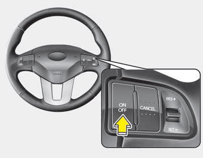

# Kia Sportage: Para desligar o controle de cruzeiro, faça uma das seguintes ações

[Home](../../index.md) / [Manual do proprietário Kia Sportage SL](../sportage-1236.md) / [Dirigindo seu veículo](sportage-1508.md) / [Sistema de controle de cruzeiro](sportage-1556.md) / Para desligar o controle de cruzeiro, faça uma das seguintes ações

- Pressione o botão ON-OFF do cruzeiro (a luz do indicador CRUISE na cluster de instrumentos se apagará).
- Desligue o ignição.

Ambas essas ações cancelarão a operação do controle de cruzeiro. Se desejar retomar a operação do controle de cruzeiro, repita os passos fornecidos em "Para definir a velocidade de cruzeiro" na página anterior.
