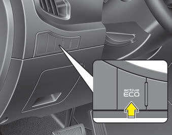

# Kia Sportage: Operação ECO Ativa

[Home](../../index.md) / [Manual do Proprietário do Kia Sportage SL](../sportage-1236.md) / [Dirigindo seu veículo](sportage-1508.md) / [Sistema ECO Ativo](sportage-1564.md) / Operação ECO Ativa

O ECO Ativo ajuda a melhorar a eficiência do combustível controlando alguns parâmetros de operação do sistema do motor e da transmissão. A eficiência do combustível depende do hábito de direção do condutor e das condições de tráfego.

- Quando o botão ECO Ativo é pressionado, a indicação ECO (verde) será acionada para mostrar que o ECO Ativo está em operação.
- Quando o ECO Ativo é ativado, permanecerá ligado até que o botão ECO Ativo seja pressionado novamente. O ECO Ativo não se desliga quando o motor é reiniciado. Para desativar o ECO Ativo, pressione o botão ECO Ativo novamente.
- Se o ECO Ativo for desativado, o sistema retornará ao modo normal.
