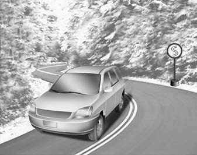

# Kia Sportage: Suavidade ao Navegar em Curvas

[Início](../../index.md) / [Manual do Proprietário do Kia Sportage SL](../sportage-1236.md) / [Dirigindo seu veículo](sportage-1508.md) / [Condições de Direção Especiais](sportage-1569.md) / Suavidade ao Navegar em Curvas

Evite frear ou trocar de marcha em curvas, especialmente quando as estradas estiverem molhadas. Idealmente,
curvas devem sempre ser tomadas com aceleração suave. Se você seguir essas sugestões,
o desgaste dos pneus será mantido ao mínimo.
