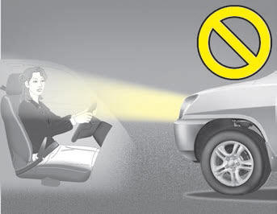

# Kia Sportage: Direção à noite

[Home](../../index.md) / [Manual do proprietário do Kia Sportage SL](../sportage-1236.md) / [Dirigindo seu veículo](sportage-1508.md) / [Condições de direção especiais](sportage-1569.md) / Direção à noite

Como a direção à noite apresenta mais riscos do que a direção durante o dia, aqui
estão algumas dicas importantes a serem lembradas:

- Diminua a velocidade e mantenha uma distância maior entre você e outros veículos, pois pode ser mais difícil enxergar à noite, especialmente em áreas onde não haja iluminação pública.
- Ajuste seus espelhos para reduzir o reflexo dos faróis dos outros motoristas.
- Manter os faróis limpos e corretamente direcionados é importante em veículos que não possuem a função de ajuste automático dos faróis. Faróis sujos ou mal direcionados tornarão muito mais difícil enxergar à noite.
- Evite olhar diretamente para os faróis dos veículos que se aproximam. Você pode ficar momentaneamente cego, e levará alguns segundos para seus olhos se adaptarem à escuridão novamente.
