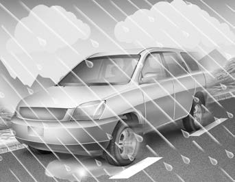

# Kia Sportage: Dirigindo na chuva

[Home](../../index.md) / [Manual do proprietário Kia Sportage SL](../sportage-1236.md) / [Dirigindo seu veículo](sportage-1508.md) / [Condições especiais de direção](sportage-1569.md) / Dirigindo na chuva

A chuva e as estradas molhadas podem tornar a direção perigosa, especialmente se você não estiver preparado para o asfalto escorregadio. Aqui estão algumas coisas a considerar ao dirigir na chuva:

- Uma chuva forte fará mais difícil a visão e aumentará a distância necessária para frear o veículo, então diminua a velocidade.
- Manter seu equipamento de limpeza de vidro em boas condições. Substitua as lâminas dos limpador de vidro quando mostrarem sinais de estrias ou áreas faltantes no vidro.
- Se seus pneus não estiverem em boas condições, fazer uma parada rápida em uma superfície molhada pode causar um deslizamento e possivelmente levar a um acidente. Certifique-se de que seus pneus estejam em boas condições.
- Ligue os faróis para tornar mais fácil para os outros te verem.
- Dirigir muito rápido por grandes poças pode afetar os freios. Se você precisar passar por poças, tente passar por elas lentamente.
- Se você acreditar que seus freios podem ter ficado molhados, aplique-os suavemente enquanto está dirigindo até que a operação de freio normal retorne.
