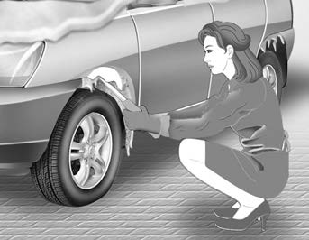

# Kia Sportage: Direção no Inverno

[Início](../../index.md) / [Manual do proprietário Kia Sportage SL](../sportage-1236.md) / [Dirigindo seu veículo](sportage-1508.md) / Direção no Inverno

Condições climáticas severas no inverno resultam em maior desgaste e outros problemas.
Para minimizar os problemas da direção no inverno, você deve seguir essas sugestões:

- [Condições nevadas ou de gelo](sportage-1580.md)
- [Use um refrigerante de etileno glicol de alta qualidade](sportage-1582.md)
- [Verifique a bateria e os cabos](sportage-1583.md)
- [Mude para óleo de "inverno" se necessário](sportage-1584.md)
- [Verifique as bobinas de ignição e o sistema de ignição](sportage-1585.md)
- [Para evitar que os travamentos congelem](sportage-1586.md)
- [Use um anti-congelação aprovado no sistema de lavagem de vidros](sportage-1587.md)
- [Não deixe o travamento de estacionamento congelar](sportage-1588.md)
- [Não deixe o gelo e a neve acumularem sob o veículo](sportage-1589.md)
- [Leve equipamento de emergência](sportage-1590.md)
