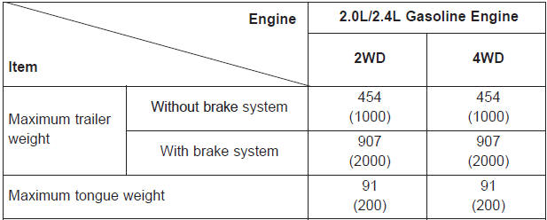

# Kia Sportage: Se você decidir puxar um remorco

[Início](../../index.md) / [Manual do proprietário Kia Sportage SL](../sportage-1236.md) / [Dirigindo seu veículo](sportage-1508.md) / [Puxar um remorco](sportage-1591.md) / Se você decidir puxar um remorco

Aqui estão alguns pontos importantes se você decidir puxar um remorco:

- Considere o uso de um controle de balanço. Você pode perguntar a um revendedor de remolque sobre o controle de balanço.
- Não faça puxamento com seu carro durante os primeiros 2.000 km (1.200 milhas) para permitir que o motor se adeque corretamente. Ignorar essa precaução pode resultar em danos graves ao motor ou à transmissão.
- Quando puxar um remorco, consulte um revendedor autorizado da Kia para obter informações adicionais, como um kit de puxamento, etc.
- Dirija sempre seu veículo a uma velocidade moderada (menos de 100 km/h (60 mph)).
- Em uma subida longa e íngreme, não ultrapasse 70 km/h (45 mph) ou a velocidade de puxamento permitida, o que for menor.
- O gráfico contém considerações importantes relacionadas ao peso:

2WD : Tracção nas rodas dianteiras

4WD : Tracção nas quatro rodas

Para identificar a capacidade de tração do veículo para o remorco, você deve ler as informações em “Peso do remorco” que aparecem mais adiante nesta seção.

- [Peso do remorco](sportage-1602.md)
- [Peso da ponta do remorco](sportage-1603.md)
