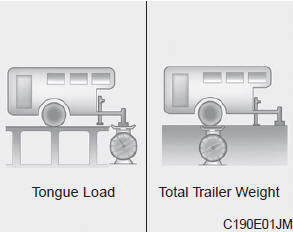

# Kia Sportage: Peso do carro-puxador

[Início](../../index.md) / [Manual do proprietário do Kia Sportage SL](../sportage-1236.md) / [Dirigindo seu veículo](sportage-1508.md) / [Puxando um carro-puxador](sportage-1591.md) / [Se você decidir puxar um carro-puxador](sportage-1601.md) / Peso do carro-puxador

Qual é o peso máximo seguro para um carro-puxador? Nunca deve pesar mais do que o peso máximo do carro-puxador com freios do carro-puxador. Mas até mesmo isso pode ser muito pesado.

Isso depende do modo como você planeja usar seu carro-puxador. Por exemplo, velocidade, altitude, inclinação da estrada, temperatura ambiente e a frequência com que seu veículo é usado para puxar um carro-puxador são todos importantes. O peso ideal do carro-puxador também pode depender de qualquer equipamento especial que você tenha no seu veículo.
