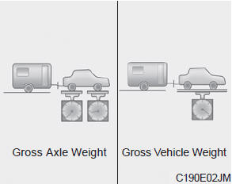

# Kia Sportage: Peso da ponta da carroça

[Home](../../index.md) / [Manual do proprietário Kia Sportage SL](../sportage-1236.md) / [Dirigindo seu veículo](sportage-1508.md) / [Puxando uma carroça](sportage-1591.md) / [Se você decidir puxar uma carroça](sportage-1601.md) / Peso da ponta da carroça

O peso da ponta da carroça é um peso importante que deve ser medido porque afeta
o peso bruto total do veículo (PBT) do seu veículo. Este peso inclui o peso bruto em movimento do veículo, qualquer carga que você possa transportar nele e as pessoas que irão viajar nele. E se você puxar uma carroça, você deve adicionar o peso da ponta da carroça ao PBT porque seu veículo também estará transportando esse peso.

A ponta da carroça deve pesar no máximo 10% do peso total da carroça carregada, dentro dos limites do peso máximo permitido da ponta da carroça. Depois que você carregar sua carroça, pesquise a carroça e depois a ponta da carroça separadamente para ver se os pesos estão corretos. Se não estiverem, você pode corrigi-los simplesmente movendo alguns itens na carroça.

AVISO - Carroça

*Sempre siga as instruções de carregamento fornecidas com sua carroça. Carregamento inadequado pode afetar a operação do veículo e resultar em um acidente.*
