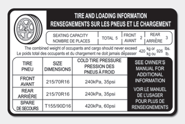
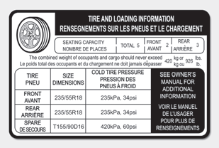

# Kia Sportage: Rótulo de informações de pneus e carga

[Home](../../index.md) / [Manual do proprietário Kia Sportage SL](../sportage-1236.md) / [Dirigindo seu veículo](sportage-1508.md) / [Limite de carga do veículo](sportage-1604.md) / Rótulo de informações de pneus e carga

O rótulo localizado no batente da porta do motorista fornece o tamanho original dos pneus, as pressões recomendadas para pneus frios do seu veículo, o número de pessoas que podem estar no seu veículo e o peso de capacidade do veículo.

**Peso de capacidade do veículo:**

5 pessoas : 420 kg (926 lbs.)

O peso de capacidade do veículo é o peso máximo combinado de passageiros e carga. Se o seu veículo estiver equipado com um remolho, o peso combinado inclui o carregamento da ponta.

**Capacidade de assentos:**

Total : 5 pessoas

- Assento dianteiro : 2 pessoas

- Assento traseiro : 3 pessoas

A capacidade de assentos é o número máximo de passageiros, incluindo o condutor, que o seu veículo pode transportar.

No entanto, a capacidade de assentos pode ser reduzida com base no peso de todos os passageiros e no peso da carga transportada ou puxada.

Não sobrecarregue o veículo, pois há um limite para o peso total ou limite de carga, incluindo passageiros e carga, que o veículo pode transportar.

**Capacidade de puxar:**

Sem freios de remolho: 454 kg (1000 lbs)

Com freios de remolho: 907 kg (2000 lbs)

A capacidade de puxar é o peso máximo do remolho, incluindo o peso da carga, que o seu veículo pode puxar.

**Passos para determinar o limite correto de carga**

1. Localize a declaração "O peso combinado de passageiros e carga nunca deve exceder XXX kg ou XXX lbs." no placar do seu veículo.

2. Determine o peso combinado do condutor e dos passageiros que irão viajar no seu veículo.

3. Subtraia o peso combinado do condutor e dos passageiros de XXX kg ou XXX lbs.

4. O resultado dessa operação é a quantidade disponível de capacidade de carga e bagagem. Por exemplo, se o "XXX" for igual a 635 kg (1400 lbs.) e houver cinco passageiros de 68 kg (150 lbs.) no seu veículo, a quantidade de capacidade de carga e bagagem disponível é 295 kg (650 lbs).

(635 - 340 (5 x 68) = 295 kg ou 1400 - 750 (5 x 150) = 650 lbs.)

5. Determine o peso combinado de bagagem e carga a ser carregada no veículo. Esse peso não pode exceder a capacidade de carga e bagagem disponível calculada no passo 4.

6. Se o seu veículo estiver puxando um remolho, a carga do seu remolho será transferida para o seu veículo. Consulte este manual para determinar como isso reduz a capacidade de carga e bagagem disponível do seu veículo.
