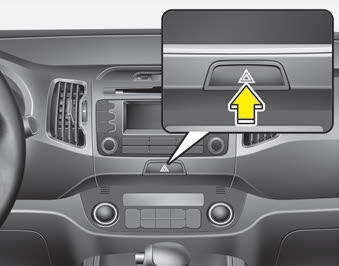

# Kia Sportage: Farol de advertência de perigo

[Home](../../index.md) / [Manual do proprietário do Kia Sportage SL](../sportage-1236.md) / [O que fazer em caso de emergência](sportage-1608.md) / [Advertência de estrada](sportage-1609.md) / Farol de advertência de perigo

O farol de advertência de perigo serve como uma advertência aos outros motoristas para que exerçam grande cautela ao se aproximar, ultrapassar ou passar pelo seu veículo.

Deve ser usado sempre que estiver sendo realizadas reparos de emergência ou quando o veículo estiver parado próximo ao limite de uma via.

Comprimar o interruptor do farol de advertência com o interruptor de ignição em qualquer posição. O interruptor do farol de advertência está localizado no painel de interruptores do console central. Todas as luzes dos indicadores de direção vão piscar simultaneamente.

- O farol de advertência de perigo opera independentemente se o veículo estiver ligado ou não.
- Os indicadores de direção não funcionam quando o farol de advertência está ligado.
- Cuidado deve ser tomado ao usar o farol de advertência de perigo enquanto o veículo estiver sendo removido.
