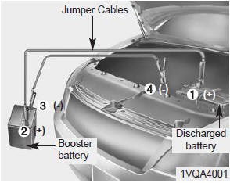

# Kia Sportage: Início de emergência

[Início](../../index.md) / [Manual do proprietário Kia Sportage SL](../sportage-1236.md) / [O que fazer em caso de emergência](sportage-1608.md) / Início de emergência

Conecte as baterias em ordem numérica e desconecte no sentido contrário.

- [Início de emergência com auxílio de outra bateria](sportage-1614.md)
- [Início de emergência por empurrão](sportage-1615.md)
