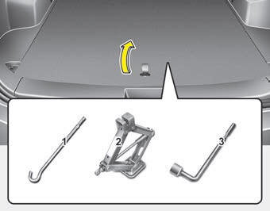

# Kia Sportage: Jack e ferramentas

[Home](../../index.md) / [Manual do proprietário Kia Sportage SL](../sportage-1236.md) / [O que fazer em caso de emergência](sportage-1608.md) / [Se você tem um pneu furado](sportage-1617.md) / Jack e ferramentas

O jacto, a alavanca do jacto e o chavelete para desafundar os parafusos do pneu estão armazenados na garagem.

Lift a tampa do porta-malas para alcançar esse equipamento.

(1) Alavanca do jacto

(2) Jacto

(3) Chavelete para desafundar os parafusos do pneu

**Instruções de jacto**

O jacto é fornecido apenas para a troca de pneus em caso de emergência.

Para evitar que o jacto "rache" enquanto o veículo estiver em movimento, armazene-o
corretamente.

Siga as instruções de jacto para reduzir a possibilidade de lesões pessoais.

AVISO - Jacto

*Não coloque nenhuma parte do seu corpo sob um veículo que está apenas suportado
por um jacto, pois o veículo pode cair do jacto. Use suportes de veículo.*

- Sempre mova o veículo completamente fora da estrada e para o acostamento antes
de tentar trocar o pneu. O jacto deve ser usado em um local firme e nivelado. Se
você não puder encontrar um local firme e nivelado fora da estrada, chame uma
empresa de reboque para assistência.
- Certifique-se de usar as posições corretas de jacto na frente e no fundo do veículo;
nunca use os para-choques ou qualquer outra parte do veículo como suporte do jacto.

AVISO - Troca de pneus

*Nunca tente reparos em veículos nas faixas de tráfego de uma estrada pública.*

- Não permita que ninguém permaneça no veículo enquanto ele estiver no jacto.
- Certifique-se de que qualquer criança presente esteja em um local seguro, longe da estrada
e do veículo a ser elevado com o jacto.

AVISO - Motor em funcionamento sobre o jacto

*Não inicie ou deixe o motor do veículo funcionando enquanto o veículo estiver sobre o
jacto, pois isso pode causar o veículo a cair do jacto.*
