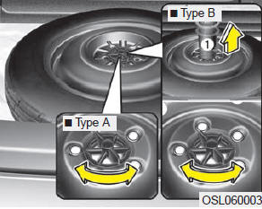

# Kia Sportage: Removendo e armazenando a roda de备胎

[Home](../../index.md) / [Manual do proprietário Kia Sportage SL](../sportage-1236.md) / [O que fazer em caso de emergência](sportage-1608.md) / [Se você tiver uma pneu furado](sportage-1617.md) / Removendo e armazenando a roda de备胎

Vire o parafuso do wing da fixação da roda no sentido horário.

Armazene a roda na ordem inversa à remoção.

Para prevenir que a roda de备胎和工具在车辆行驶过程中“晃动”,
armazene-os corretamente.
