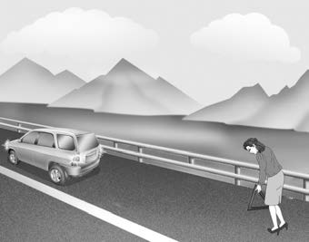
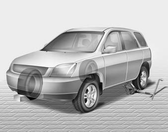
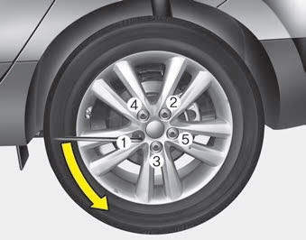
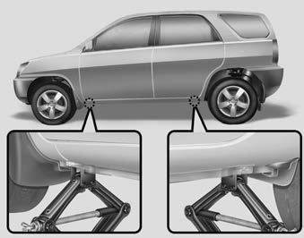
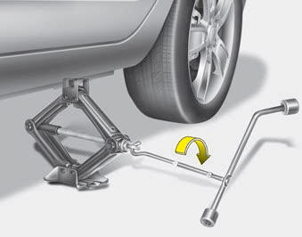
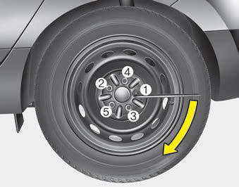

# Kia Sportage: Mudando os pneus

[Home](../../index.md) / [Manual do proprietário Kia Sportage SL](../sportage-1236.md) / [O que fazer em caso de emergência](sportage-1608.md) / [Se você tiver um pneu furado](sportage-1617.md) / Mudando os pneus

1. Pare em um local plano e aplique o freio de estacionamento firmemente.

2. Coloque o alavanca do câmbio transaxial em R (Ré) com transmissão manual ou P (Park) com transmissão automática.

3. Ative o indicador de advertência de freio a disco.

4. Remova a chave de desacoplamento dos parafusos de fixação do pneu, o jaleque, a alavanca do jaleque e o pneu de emergência do veículo.

5. Bloqueie tanto o dianteiro quanto o traseiro do pneu que está diagonalmente oposto à posição do jaleque.

• Para prevenir o movimento do veículo durante a troca de pneu, sempre acione o freio de estacionamento completamente e sempre bloqueie o pneu diagonalmente oposto ao pneu que está sendo trocado.

• Recomendamos que os pneus do veículo sejam bloqueados e que nenhuma pessoa permaneça no veículo enquanto ele estiver sendo levantado.

6. Desacople os parafusos de fixação do pneu em sentido anti-horário uma volta cada, mas não remova nenhum parafuso até que o pneu esteja levantado do chão.

7. Coloque o jaleque na posição de levantamento mais próxima do pneu que está sendo trocado. Coloque o jaleque nas localizações designadas sob o chassi.

8. Insira a alavanca do jaleque no jaleque e vire-a em sentido horário, levantando o veículo até que o pneu apenas se afaste do chão. Esta medida é aproximadamente 30 mm (1 polegada).

Antes de remover os parafusos de fixação do pneu, assegure-se de que o veículo esteja estável e que não haja chance de movimento ou escorregamento.

9. Desacople os parafusos de fixação do pneu com as mãos e remova-os. Deslize o pneu pelos parafusos e deite-o de lado para que não possa rolar. Para colocar o pneu no eixo, pegue o pneu de emergência, alinhe os orifícios com os parafusos e deslize o pneu sobre eles. Se isso for difícil, incline o pneu levemente e alinhe o orifício superior do pneu com o parafuso superior. Em seguida, jogue o pneu de um lado para o outro até que ele possa deslizar sobre os outros parafusos.

Os pneus podem ter bordos afiados. Trate-os com cuidado para evitar possíveis ferimentos graves.
Antes de colocar o pneu em seu lugar, assegure-se de que não há nada no eixo ou no pneu (como lama, asfalto, pedras, etc.) que impeça o pneu de se encaixar firmemente no eixo.

AVISO - Instalando um pneu

*Assegure-se de que o pneu faça bom contato com o eixo quando instalado. Se o contato da superfície de montagem entre o pneu e o eixo não for bom, os parafusos de fixação do pneu podem soltar e causar a perda de um pneu. A perda de um pneu pode resultar na perda de controle do veículo.*

10. Para instalar o pneu, segure-o nos parafusos, coloque os parafusos de fixação do pneu nos parafusos e aperte-os com as mãos. Agite o pneu para se assegurar de que ele esteja completamente posicionado, depois aperte os parafusos com as mãos novamente o máximo possível.

11. Baixe o veículo ao solo girando o parafuso do travão do roda no sentido horário.

Em seguida, posicione o parafuso conforme indicado no desenho e aperte os parafusos das rodas. Certifique-se de que a fivela esteja completamente posicionada sobre o parafuso. Não se apoie na alavanca do parafuso ou use um tubo de extensão sobre a alavanca do parafuso. Vire cada parafuso seguindo a sequência numérica mostrada na imagem até que todos estejam apertados. Em seguida, verifique novamente cada parafuso para aperto. Após trocar as rodas, tenha um concessionário autorizado da Kia apertando os parafusos das rodas ao torque correto o mais rápido possível.

Torque de aperto dos parafusos das rodas:

9~11 kg·m (65~79 lb·ft)

Se você tiver um medidor de pressão de pneu, remova a tampa do válvulo e verifique a pressão do ar. Se a pressão for menor do que o recomendado, dirija lentamente até a próxima estação de serviço e infla até a pressão correta. Se a pressão for muito alta, ajuste-a até que esteja correta. Sempre reinstale a tampa do válvulo após verificar ou ajustar a pressão do pneu. Se a tampa não for substituída, poeira e sujeira podem entrar no válvulo do pneu e causar vazamento de ar do pneu. Se perder a tampa do válvulo, compre outra e instale-a o mais rápido possível.

Depois de trocar as rodas, sempre fixe o pneu furado em seu lugar e retorne o jipe e as ferramentas ao seu local de armazenamento apropriado.

CAUTION - Reutilização dos parafusos de roda

*Certifique-se durante a remoção da roda de que os mesmos parafusos que foram removidos sejam reutilizados - ou, se substituídos, que sejam usados parafusos com fios métricos e a mesma configuração de cunha. Seu veículo tem fios métricos nas estacas e parafusos das rodas. A instalação de um parafuso com fios não métricos em uma estaca métrica não apertará a roda no eixo corretamente e danificará a estaca, que precisará ser substituída.*

Note que a maioria dos parafusos de roda não tem fios métricos. Certifique-se de que tome cuidado extremo ao verificar o tipo de fio antes de instalar parafusos de roda ou rodas aftermarket. Se tiver dúvida, consulte um concessionário autorizado da Kia.

WARNING - Estacas de roda

*Se as estacas estiverem danificadas, podem perder a capacidade de reter a roda. Isso pode levar à perda da roda e a um acidente.*

Para prevenir o jipe, a alavanca do jipe, a alavanca do parafuso das rodas e o pneu de备胎在车辆行驶过程中发出晃动声，应妥善存放它们。

在安装备胎后尽快检查充气压力。如有必要，请调整至规定压力。参见第8节中的“轮胎和轮毂”。

- [重要 - 使用紧凑型备胎](sportage-1621.md)
