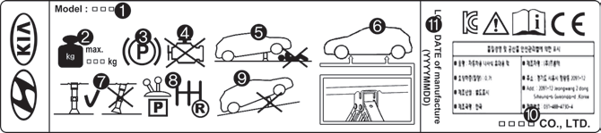
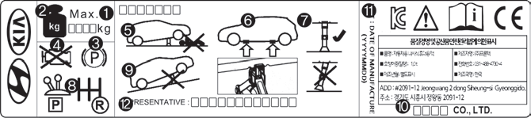
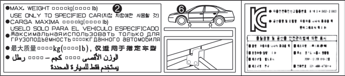

# Kia Sportage: Etiqueta do Suporte

[Início](../../index.md) / [Manual do Proprietário do Kia Sportage SL](../sportage-1236.md) / [O que fazer em caso de emergência](sportage-1608.md) / [Se você tem um pneu furado](sportage-1617.md) / Etiqueta do Suporte

Tipo A

Tipo B

Tipo C

1. Nome do modelo

2. Carga máxima permitida

3. Ao usar o suporte, coloque o freio de estacionamento.

4. Ao usar o suporte, pare o motor.

5. Não entre sob um veículo suportado por um suporte.

6. Locais designados sob o quadro

7. Ao suportar o veículo, a base do suporte deve estar vertical sob o ponto de levantamento.

8. Coloque a caixa de marchas em Ré no caso de transmissão manual ou mova o lembrete de marcha para a posição P no caso de transmissão automática.

9. O suporte deve ser usado em terreno firme e nivelado.

10. Fabricante do suporte

11. Data de produção

12. Empresa representante e endereço
