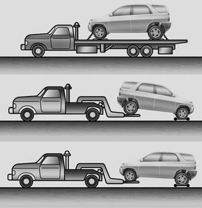
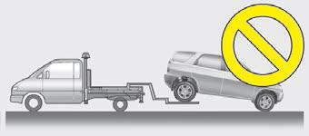
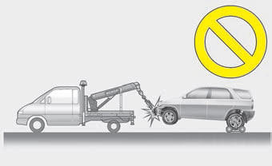

# Kia Sportage: Serviço de Remoção

[Home](../../index.md) / [Manual do Proprietário Kia Sportage SL](../sportage-1236.md) / [O que fazer em situações de emergência](sportage-1608.md) / [Remoção](sportage-1623.md) / Serviço de Remoção

Se a remoção emergencial for necessária, recomendamos que seja realizada por um concessionário aprovado da Kia ou um serviço de remoção comercial. É necessário seguir procedimentos adequados de levantamento e remoção para evitar danos ao veículo. O uso de dolly de rodas ou plataforma é recomendado.

Para informações sobre diretrizes de remoção de carretas, consulte "Remoção de carretas" na seção 5.

Em veículos 4WD, o veículo deve ser removido com um dolly de rodas e equipamento de plataforma com todas as rodas levantadas do solo.

CAUTION - Serviço de Remoção

*Não remova veículos 4WD com as rodas dianteiras no solo. Isso pode causar danos sérios à transaxle ou ao sistema 4WD.*

Em veículos 2WD, é aceitável remover o veículo com as rodas traseiras no solo (sem dolly) e as rodas dianteiras levantadas.

Se quaisquer das rodas carregadas ou componentes de suspensão estiverem danificados ou o veículo estiver sendo removido com as rodas dianteiras no solo, use um dolly de remoção sob as rodas dianteiras.

Quando o veículo estiver sendo removido por um serviço de remoção comercial e não forem utilizados dolly de rodas, o início do veículo deve sempre ser levantado, não o final.

WARNING - Airbag laterais e cortina

*Se o seu veículo estiver equipado com airbag laterais e cortina, coloque o interruptor de ignição na posição LOCK ou ACC quando o veículo estiver sendo removido.*

*O airbag laterais e cortina podem ser ativados quando o interruptor de ignição estiver ligado e o sensor de rolamento detectar a situação como uma rolagem.*

CAUTION - Remoção

- *Não remova o veículo em reversa com as rodas dianteiras no solo, pois isso pode causar danos ao veículo.*
- *Não remova com equipamento de cinto. Use dolly de rodas ou plataforma.*

Quando removendo o seu veículo em emergência sem dolly de rodas:

1. Coloque o interruptor de ignição na posição ACC.

2. Coloque o alavancar de engrenagem da transaxle em N (Neutro).

3. Libere o travamento de estacionamento.

CAUTION - Posição do engrenagem de remoção

*Omissão de coloquem o alavancar de engrenagem da transaxle em N (Neutro) pode causar danos internos à transaxle.*

*✽ NOTA*

*Remoção requer equipamento adicional. Consulte o Manual do Proprietário para capacidade de remoção, instruções adicionais e avisos. Sempre use cuidado ao remover.*
