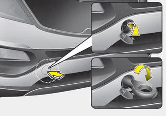
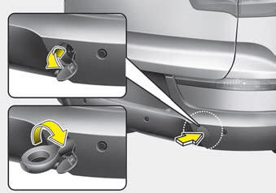

# Kia Sportage: Removível Arrancador

[Home](../../index.md) / [Manual do Proprietário do Kia Sportage SL](../sportage-1236.md) / [O que fazer em caso de emergência](sportage-1608.md) / [Arrastamento](sportage-1623.md) / Removível arrancador

Front

Rear

1. Abra o porta-malas e remova o arrancador do caso de ferramentas.

2. Remova a tampa do orifício pressionando a parte inferior da tampa no para-choque.

3. Instale o arrancador girando-o no sentido horário até que ele esteja totalmente fixo no orifício.

4. Remova o arrancador e instale a tampa após o uso.
