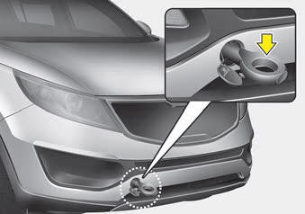
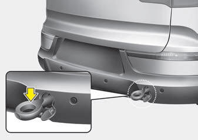
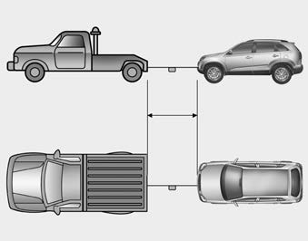

# Kia Sportage: Towing de Emergência

[Início](../../index.md) / [Manual do Proprietário do Kia Sportage SL](../sportage-1236.md) / [O que fazer em caso de emergência](sportage-1608.md) / [Towing](sportage-1623.md) / Towing de Emergência

Dianteira

Traseira

Se for necessário o towing, contrate um concessionário autorizado da Kia ou um serviço de towing comercial.

Se não estiver disponível um serviço de towing em caso de emergência, seu veículo pode ser temporariamente towado usando um cabo ou correntes presas ao gancho de towing de emergência sob a dianteira (ou traseira) do veículo. Use extrema cautela ao towar o veículo. Um motorista deve estar no veículo para direcioná-lo e operar os freios.

O towing dessa maneira pode ser realizado apenas em estradas com superfície dura por uma curta distância e a baixa velocidade. Além disso, os pneus, os eixos, a transmissão, o direção e os freios devem estar em boas condições.

- Não use os ganhos de towing para puxar um veículo de lama, areia ou outras condições em que o veículo não pode ser puxado por sua própria potência.
- Evite towar um veículo mais pesado que o veículo que está fazendo o towing.
- Os motoristas dos dois veículos devem se comunicar frequentemente.

CAUTION

- *Aferre um cabo de towing ao ganho de towing.*
- *Usar uma parte do veículo, exceto os ganhos de towing, para towing pode
	danificar o corpo do seu veículo.*
- *Apenas use um cabo ou correntes especificamente intencionadas para uso em towing de veículos.
	Aferre o cabo ou correntes de forma segura ao ganho de towing fornecido.*

- Antes de realizar o towing de emergência, verifique se o ganho não está quebrado ou danificado.
- Aferre o cabo ou correntes de towing de forma segura ao ganho.
- Não solte o ganho de forma brusca. Aferre-o gradualmente e com força uniforme.
- Para evitar danificar o ganho, não puxe de lado ou em ângulo vertical.
	 sempre puxe em linha reta.

- Use um cabo de towing com menos de 5 m (16 pés) de comprimento. Aferre um pano branco ou vermelho (aproximadamente 30 cm (12 polegadas) de largura) no meio do cabo para melhor visibilidade.
- Dirija com cuidado para que o cabo de towing não fique solto durante o towing.

- [Precauções de towing de emergência](sportage-1627.md)
