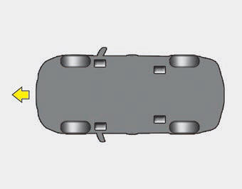

# Kia Sportage: Aro de fixação (para remoção em plataforma)

[Home](../../index.md) / [Manual do proprietário Kia Sportage SL](../sportage-1236.md) / [O que fazer em caso de emergência](sportage-1608.md) / [Remoção](sportage-1623.md) / Aro de fixação (para remoção em plataforma)

AVISO - Aros de fixação na frente

*Não use os aros de fixação na frente do veículo para fins de remoção.
Estes aros são projetados ÚNICAMENTE para fixação de transporte. Se os aros de fixação forem
usados para remoção, os aros de fixação ou o baltim da frente serão danificados.*
