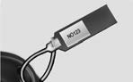

# Kia Sportage: Registre o número da sua chave

[Home](../../index.md) / [Manual do proprietário Kia Sportage SL](../sportage-1236.md) / [Características do seu veículo](sportage-1309.md) / [Chaves](sportage-1310.md) / Registre o número da sua chave

O número da chave está estampado na etiqueta de código de chave fixada ao conjunto de chaves. Se você perder suas chaves, este número permitirá que um concessionário autorizado da Kia duplique as chaves facilmente. Remova a etiqueta de código de chave e armazene-a em um local seguro. Além disso, registre o número da chave e armazene-o em um local seguro e acessível, mas não no veículo.
