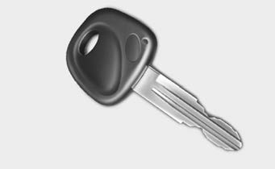
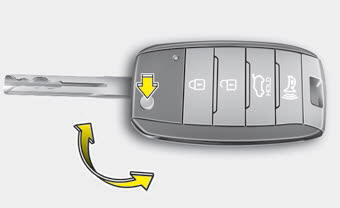
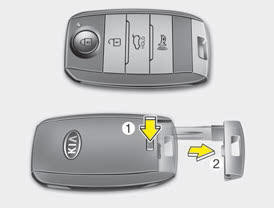

# Kia Sportage: Operações das chaves

[Início](../../index.md) / [Manual do proprietário do Kia Sportage SL](../sportage-1236.md) / [Características do seu veículo](sportage-1309.md) / [Chaves](sportage-1310.md) / Operações das chaves

Tipo A

- Usado para ligar o motor.
- Usado para trancar e destrancar as portas.

Tipo B

Para desdobrar a chave, pressione o botão de liberação e a chave se desdobrará automaticamente.

Para dobrar a chave, dobre a chave manualmente enquanto pressiona o botão de liberação.

CAUTION

*Não dobrar a chave sem pressionar o botão de liberação. Isso pode danificar a chave.*

Tipo C

Para remover a chave mecânica, pressione e segure o botão de liberação (1) e remova a chave mecânica (2).

Para reinstalar a chave mecânica, coloque a chave na abertura e empurre até ouvir um clique.

WARNING - Chave de ignição (chave inteligente)

*Nunca deixe as chaves no veículo com crianças sob sua supervisão. Deixar crianças sem supervisão em um veículo com uma chave de ignição manual ou inteligente é perigoso.*

*As crianças copiam os adultos e podem colocar a chave no interruptor de ignição ou pressionar o botão de start. A chave permitiria que as crianças operassem as janelas elétricas ou outros controles, ou até mesmo fizessem o veículo se mover, o que poderia resultar em lesões graves ou morte.*

WARNING - Chave aftermarket

*Use apenas peças originais da Kia para a chave de ignição do seu veículo. Se uma chave aftermarket for usada, o interruptor de ignição pode não retornar ao ON após START. Se isso acontecer, o starter continuará operando, causando danos ao motor starter e possível incêndio devido ao excesso de corrente na cablagem.*
