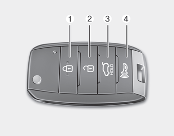

# Kia Sportage: Operações do sistema de entrada sem chave

[Início](../../index.md) / [Manual do proprietário do Kia Sportage SL](../sportage-1236.md) / [Características do seu veículo](sportage-1309.md) / [Entrada sem chave](sportage-1315.md) / Operações do sistema de entrada sem chave

**Bloqueio (1)**

Todas as portas (e porta-malas) são bloqueadas se o botão de bloqueio for pressionado.

Se todas as portas (e porta-malas) estiverem fechadas, as luzes de advertência de perigo piscarão uma vez para indicar que todas as portas (e porta-malas) estão bloqueadas.

Se o botão de bloqueio for pressionado novamente dentro de 4 segundos, o buzina bipará uma vez com as luzes de advertência de perigo piscando uma vez.

No entanto, se qualquer porta (ou porta-malas) permanecer aberta, as luzes de advertência de perigo não funcionarão. Mas se todas as portas (e porta-malas) estiverem fechadas após o pressionamento do botão de bloqueio, as luzes de advertência de perigo piscarão uma vez.

**Desbloqueio (2)**

A porta do motorista será desbloqueada se o botão de desbloqueio for pressionado uma vez. As luzes de advertência de perigo piscarão duas vezes para indicar que a porta do motorista foi desbloqueada.

Todas as portas (e porta-malas) serão desbloqueadas se o botão de desbloqueio for pressionado novamente dentro de 4 segundos. As luzes de advertência de perigo piscarão duas vezes novamente para indicar que todas as portas (e porta-malas) foram desbloqueadas.

Após pressionar este botão, as portas (e porta-malas) serão bloqueadas automaticamente a menos que você abra qualquer porta nos próximos 30 segundos.

O desbloqueio em duas etapas pode ser desabilitado ou reabilitado pressionando simultaneamente o botão de bloqueio (1) e o botão de desbloqueio (2) por 4 segundos (a desabilitação do desbloqueio em duas etapas permite que todas as portas do veículo sejam desbloqueadas simultaneamente). As luzes de advertência de perigo piscarão quatro vezes para indicar que o desbloqueio em duas etapas foi habilitado ou desabilitado.

**Alarme (3)**

A buzina soará e as luzes de advertência de perigo piscarão por cerca de 30 segundos se este botão for pressionado por mais de 0,5 segundos. Para parar a buzina e as luzes, pressione qualquer botão do transmissor.
