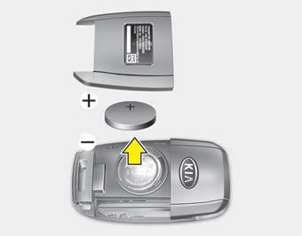

# Kia Sportage: Troca da Bateria

[Home](../../index.md) / [Manual do Proprietário do Kia Sportage SL](../sportage-1236.md) / [Características do seu veículo](sportage-1309.md) / [Entrada sem chave remota](sportage-1315.md) / Troca da Bateria

Um transmissor usa uma bateria de lítio de 3 volts que normalmente durará vários anos. Quando a troca for necessária, siga o procedimento a seguir.

1. Insira uma ferramenta fina na ranhura e, suavemente, arqueie o cobre central do transmissor.

2. Substitua a bateria com uma nova bateria (CR2032). Ao substituir a bateria, certifique-se de que a posição da bateria esteja correta.

3. Instale a bateria na ordem inversa à remoção.

Para a troca do transmissor, consulte um concessionário autorizado da Kia para reprogramar o transmissor.

- O sistema de entrada sem chave do transmissor está projetado para lhe proporcionar anos de uso sem problemas, no entanto, pode falhar se exposto a umidade ou eletrostática. Se você estiver incerto sobre como usar o seu transmissor ou substituir a bateria, entre em contato com um concessionário autorizado da Kia.
- Usar a bateria errada pode fazer com que o transmissor falhe. Certifique-se de usar a bateria correta.

*NOTA*

*Uma bateria mal descartada pode ser prejudicial ao meio ambiente e à saúde humana.*

*Descarte a bateria de acordo com as leis ou regulamentos locais.*

*AVISO INDÚSTRIA*

*Este dispositivo atende aos padrões RSS sem licença da Indústria Canadense.* 

*A operação está sujeita às seguintes duas condições: (1) este dispositivo não deve causar interferência, e (2) este dispositivo deve aceitar qualquer interferência, incluindo interferência que possa causar operação indesejada do dispositivo.*
